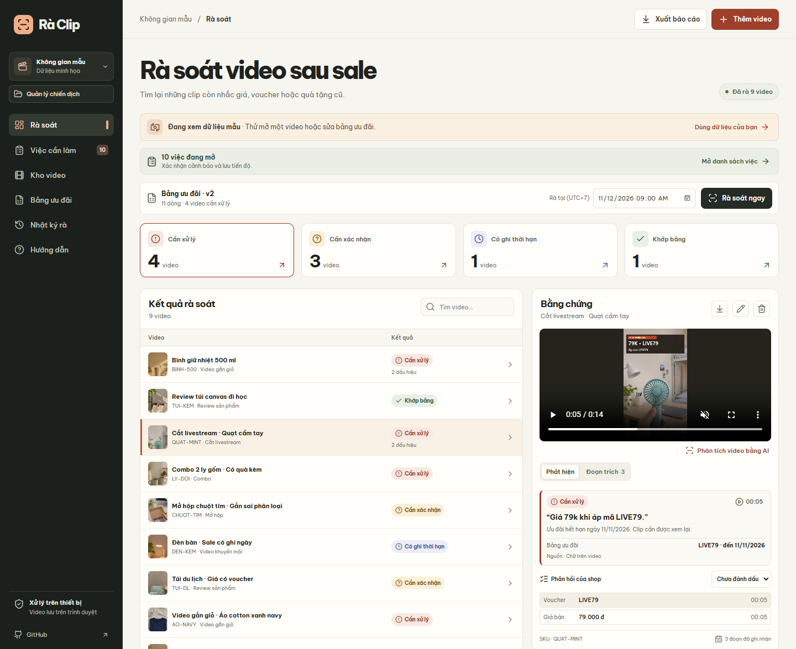

# Rà Clip

Kiểm bản nháp trước khi đăng và rà lại video bán hàng khi giá, voucher hoặc quà tặng thay đổi. Rà Clip đọc lời thoại và chữ tiếng Việt, đối chiếu theo mã phân loại sản phẩm (SKU) và chỉ ra đoạn cần xem.



## Chạy trên web

Mở [Rà Clip trên GitHub Pages](https://laian2006.github.io/ra-clip/) để thử với dữ liệu mẫu hoặc dữ liệu của bạn. Sau khi cập nhật `main`, GitHub Actions kiểm thử và đưa bản build đạt kiểm thử lên web.

Dữ liệu lưu trong trình duyệt theo địa chỉ web. Nếu chuyển từ bản trên máy sang bản web, tải file `.raclip` trong mục **Quản lý chiến dịch** trên bản cũ rồi chọn **Mở bản sao lưu** trên bản web.

## Chạy trên máy

Cần Node.js 22.12+ (dòng 22) hoặc 24+ và trình duyệt hiện đại.

```sh
npm ci
npm run dev
```

Mở địa chỉ Vite in ra, thường là `http://127.0.0.1:5173`. App mở với **9 video dọc có thể phát**, lời thoại tiếng Việt, phụ đề và 2 phiên bản bảng ưu đãi. Dữ liệu và video được dựng để tái hiện tình huống shop có thể gặp sau sale.

### Thử nhanh với video mẫu

Từ màn hình đầu, chọn **Xem một cảnh báo mẫu** để tới đúng clip và mốc có ưu đãi hết hạn. Bấm **Đến 00:05** để tua đoạn gốc. Trên điện thoại, nút **Về danh sách video** đưa bạn trở lại danh sách.

1. Mở **Kho video**, chọn **Cắt livestream**, rồi mở clip quạt mini. Đoạn **00:05** hiển thị giá 79k với mã đã hết hạn. Mức 199k ở đoạn sau là ngưỡng đơn để dùng mã.
2. Trong **Bảng ưu đãi**, chọn **So sánh phiên bản** để thấy áo navy đổi từ 139.000đ lên 159.000đ và combo ly bỏ quà tặng.
3. Mở **Việc cần làm**, lọc theo SKU, ghi chú và bấm tên video để về đúng phát hiện. Trong **Đoạn trích**, có thể xem, thêm, sửa và xóa từng đoạn lời thoại hoặc OCR.
4. Mở **Nhật ký rà** để tải lại báo cáo theo từng lần rà. Nhật ký hiện clip mới cần kiểm tra hoặc đã hết dấu hiệu giữa hai lần rà.

Danh sách 9 tình huống và mốc kiểm tra có trong [kho video mẫu](docs/video-mau.md).

## Chọn công cụ theo việc cần làm

- **KOC và người làm video** mở **Kiểm nhanh bản nháp**, dán kịch bản, nhập phụ đề hoặc thêm file để đọc chữ và lời thoại. Điền ưu đãi shop xác nhận hoặc mở phiếu shop gửi, chọn giờ dự kiến đăng rồi xem lý do, đoạn gốc và tải CSV. Lần kiểm này dùng riêng trên trang Kiểm nhanh.
- **Chủ shop và vận hành** mở **Lịch đổi ưu đãi** để xem mốc bắt đầu, hết hạn, các clip phát sinh cảnh báo và clip thiếu bằng chứng. Lịch mô phỏng ngay trước và sau mỗi mốc theo phiên bản bảng mới nhất. Trong **Lịch đổi ưu đãi** hoặc **Bảng ưu đãi**, chọn **Tạo phiếu cho KOC** để sao chép hoặc tải thông tin của một SKU và ưu đãi được chọn.
- **Agency và người quản lý KOC** mở **Điều phối người đăng** để xem số video, dữ liệu còn thiếu và tiến độ theo người đăng trong chiến dịch. Chọn nhiều clip để gán hoặc đổi người đăng cùng lúc, mở danh sách việc đã lọc hoặc soạn tin nhắc cho riêng từng người.

## Dùng cho đợt sale thật

Chọn **Dùng dữ liệu của bạn** và làm theo bước hiện trên màn hình **Rà soát**. App đề xuất nhập bảng, thêm video, gán mã sản phẩm hoặc phân tích clip theo dữ liệu đã có. Khi lưu bảng và video, kết quả đối chiếu tự cập nhật.

Sau khi cập nhật bảng, mục **Tác động của bảng** so sánh hai phiên bản ở cùng thời điểm rà. Mở từng cảnh báo để đến đúng đoạn trong video. Trong mục này hoặc **Việc cần làm**, chọn **Soạn bản nhắc** để sao chép danh sách việc còn mở của từng người đăng.

- **Chiến dịch:** mở **Quản lý chiến dịch** để tạo hoặc đổi tên từng đợt sale. Mỗi chiến dịch có kho video, bảng ưu đãi, phản hồi và nhật ký riêng. Chọn **Dùng dữ liệu của bạn** để vào không gian mặc định. Dữ liệu đã lưu bằng phiên bản 1.0 vẫn mở trong không gian này.
- **Bảng ưu đãi:** nhập trang đầu của XLSX hoặc file CSV/TSV có các cột `sku, name, voucher, price, gift, start, end, condition`. Dùng mẫu CSV trong app. Mỗi cặp SKU và voucher là một dòng. Dòng không có mã đại diện cho giá hoặc ưu đãi thông thường. Giá tính bằng VNĐ, thời hạn dùng giờ Việt Nam (UTC+7).
- **Kho video:** thêm MP4, WebM, M4V hoặc MOV mà trình duyệt đọc được, tối đa 150 MB và 2 phút mỗi file, tối đa 20 file mỗi lượt. Gán SKU, ngày đăng và kiểu video. Có thể dùng phụ đề SRT/VTT hoặc ghi chú như `00:05 Còn 99k khi áp mã SALE99.`
- Khi gặp file, link hoặc ID trùng trong cùng chiến dịch, app hỏi cách xử lý trước khi lưu. **Tìm video trùng** lọc các bản đã lưu. Sau khi xóa, **Hoàn tác xóa** khôi phục file, đoạn trích và phản hồi trong 30 giây hoặc trước khi chuyển chiến dịch.
- **Nhập danh sách video.** từ **Kho video** chọn **Nhập danh sách** và tải mẫu CSV nếu cần. App xem trước dòng mới, dòng cập nhật, dòng trùng và dòng lỗi. Link hoặc ID nhận diện video. Cập nhật giữ file và đoạn trích đã lưu. Cột có thể nhập gồm `title, sku, link, published, format, video_id, creator, views, orders`. Với ID dài trong Excel, đặt ô ở dạng văn bản hoặc dùng link TikTok đầy đủ. Các số liệu là số được nhập vào chiến dịch.
- **Quét hàng loạt.** chọn tối đa 20 video đã có file, chọn đọc chữ, lời thoại hoặc cả hai. Kết quả mỗi video được lưu ngay. Khi dừng, phần còn lại được giữ trong lựa chọn. Dùng bộ lọc trong kho để tìm clip thiếu SKU, bằng chứng hoặc file.
- **Rà và xử lý:** chọn thời điểm, sửa các đoạn AI đọc nhầm, đánh dấu việc riêng lẻ hoặc hàng loạt rồi tải CSV. Khi lưu bảng mới, app chỉ tính lại SKU đã đổi hoặc clip có dữ liệu mới. Khi đổi thời điểm, app tính lại toàn bộ kho. Nhật ký lưu tối đa 40 báo cáo gần nhất. Sắp xếp danh sách việc theo mức cần xử lý, số đơn hoặc lượt xem đã nhập.
- **Sao lưu:** tải file `.raclip` từ màn hình quản lý, kèm video đã nhập, ưu đãi, đoạn trích, ghi chú và báo cáo. Mở file để tạo một chiến dịch riêng. Mỗi bản sao lưu hỗ trợ tối đa 1 GB.

## Cách hoạt động

`src/media.ts` lấy mẫu khung hình trong trình duyệt. `src/speech.worker.ts` chạy PhoWhisper Base tinh chỉnh cho tiếng Việt bằng WebAssembly trong Web Worker. OCR dùng Tesseract tiếng Việt và tiếng Anh. `src/claims.ts` trích giá, voucher, quà tặng và thời hạn. `src/audit.ts` đối chiếu theo SKU và phiên bản ưu đãi. IndexedDB lưu file video và dữ liệu của từng chiến dịch.

Lần đầu dùng lời thoại, trình duyệt tải mô hình khoảng 80 MB từ Hugging Face. OCR dùng các gói đi cùng app. Nội dung video được xử lý tại chỗ. Xóa dữ liệu trang trong trình duyệt sẽ xóa các chiến dịch chưa sao lưu.

Trong hộp **Thêm video**, có thể chuẩn bị mô hình lời thoại trước khi quét. Mục **Nguồn bằng chứng** cho biết phần nào đã đọc được, phần nào gặp lỗi và cho mở trực tiếp các đoạn theo nguồn.

Kết quả phản ánh bảng shop nhập tại thời điểm rà. Giá theo từng khách hoặc điều kiện thanh toán cần dữ liệu tương ứng. AI có thể bỏ sót chữ xuất hiện trong thời gian ngắn hoặc đọc sai lời thoại có nhạc nền. Dùng clip gốc và trạng thái **Cần xác nhận** để kiểm tra các đoạn mơ hồ.

[Ảnh màn hình xem trước bảng video](docs/nhap-danh-sach.png).

Lý do chọn các tính năng này được ghi trong [nhu cầu vận hành và khả năng tiếp cận](docs/nhu-cau-va-tiep-can.md).

## Dùng bằng bàn phím và phụ đề

Nhấn **Tab** từ đầu trang để tới **Bỏ qua điều hướng**. Khi mở trang hoặc một phát hiện, tiêu điểm chuyển tới nội dung tương ứng. **Escape** đóng hộp thoại khi app đang chờ thao tác và đưa tiêu điểm về nút vừa mở. Có thể dùng bàn phím cuộn các bảng rộng trong vùng bảng.

Nút **Phụ đề** bật hoặc tắt chữ trên video và ghi nhớ lựa chọn khi chuyển clip. Với video riêng, app ưu tiên phụ đề đã nhập, rồi tới lời thoại nhận dạng hoặc đoạn nhập tay. Có thể sửa lời thoại từ mục **Đoạn trích**. Phụ đề demo đi cùng từng file.

## Kiểm thử

```sh
npm test
npm run build
npx playwright install chromium
npm run test:e2e
```

Kiểm thử bao gồm nhập Excel/CSV, lọc trùng, ưu tiên theo số đơn, quét hàng loạt và dừng an toàn, phụ đề, điều hướng bàn phím, kiểm tra axe, sao lưu và chuyển dữ liệu từ bản cũ. Bật `RA_CLIP_TEST_MODELS=1` để tải và thử PhoWhisper trong trình duyệt. Có thể chọn Edge đã cài bằng `RA_CLIP_BROWSER=msedge`.

Mã nguồn theo [MIT](LICENSE). Hình ảnh, lời thoại và dữ liệu video minh họa được tạo riêng cho demo. [Ghi chú về thành phần bên thứ ba](THIRD_PARTY.md)
